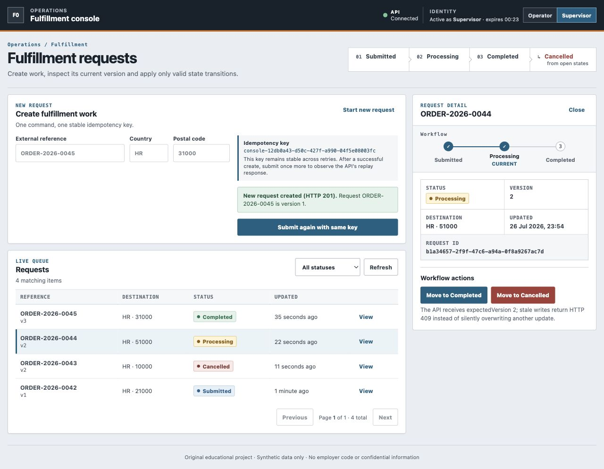
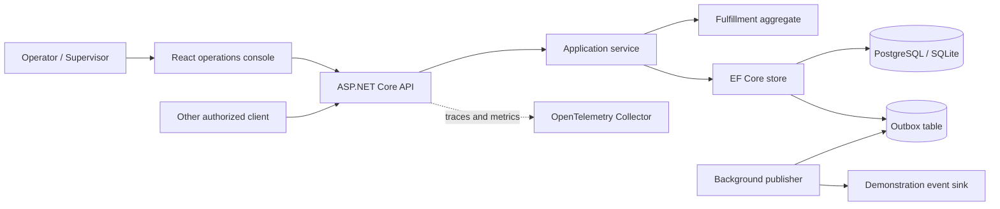

# Fulfillment Workflow API

A clean-room .NET 10 portfolio sample for failure-aware fulfillment request
processing. It demonstrates selected engineering work around a business workflow:
idempotent commands, explicit state transitions, optimistic concurrency,
a transactional outbox pattern with bounded demonstration dispatch,
authorization, observability, tests, migrations, containerized operation, and
a thin React operations console.

This is an original educational project. It contains no code, data,
configuration, or Git history from an employer or private product.



## What this project demonstrates

- ASP.NET Core APIs with RFC 9457-style Problem Details responses
- EF Core with PostgreSQL in the container/runtime path and SQLite for a fast,
  Docker-independent test path
- policy-based JWT authorization for `Operator` and `Supervisor` roles
- idempotent creation through a unique `Idempotency-Key` bound to a normalized
  SHA-256 request fingerprint
- a guarded fulfillment state machine and version-based concurrency control
- an outbox record committed with the aggregate and a bounded demonstration
  dispatcher that records failures without persisting exception messages
- OpenTelemetry traces and metrics over OTLP
- readiness/liveness health checks, rate limiting, and correlation IDs
- a React 19 and TypeScript operations console that exposes idempotency,
  permissions, state transitions, and version conflicts
- unit and HTTP integration tests, CI security gates, a non-root container, and
  reproducible database migrations
- frontend unit tests plus a real-backend Playwright workflow and axe scan

It does **not** claim production readiness, production traffic, a production
SLA, or production EF Core experience. The project is a focused, independently
implemented demonstration of those practices.

## Architecture



Dependencies point inward: Domain has no infrastructure dependencies;
Application defines ports; Infrastructure implements persistence and delivery;
API owns hosting, authentication, endpoint contracts, and composition.

See [architecture](docs/architecture.md), [threat model](docs/threat-model.md),
[testing strategy](docs/testing-strategy.md), and the
[architecture decisions](docs/decisions/). The bounded frontend scope and
security model are documented in [frontend](docs/frontend.md).

## Run without Docker

Prerequisites for the local API and console:

- .NET SDK 10;
- Node.js 22.12 or newer with npm;
- a POSIX shell with `openssl`, `curl`, and `python3`.

```bash
dotnet restore Fulfillment.slnx
sh scripts/run-development-api.sh
```

This path uses a local SQLite file and applies migrations only because the
process runs in Development. It is intended for fast evaluation and tests, not
production parity. The script starts the API at `http://127.0.0.1:5080` and
creates an untracked, process-local signing key.

Create a 30-minute development token:

```bash
sh scripts/create-dev-token.sh Supervisor
```

The `/dev/token` endpoint exists only in the `Development` environment and
requires a signing key supplied outside source control.

Run the console in a second terminal:

```bash
cd frontend
npm ci
npm run dev
```

Open `http://127.0.0.1:5173`. The console requests a development identity and
keeps its short-lived token in memory only.

To verify the documented API startup and an authenticated list request:

```bash
sh scripts/quick-start-smoke.sh
```

## Run with PostgreSQL and telemetry

```bash
cp .env.example .env
# Replace both placeholder values in .env.
docker compose up --build
```

Compose runs a one-shot `migrations` service before the API. The normal API
process never applies PostgreSQL migrations on startup.

The console and API are available from the same origin at
`http://localhost:8080`; readiness is exposed at `/health/ready`. The collector
prints exported trace and metric summaries:

```bash
docker compose logs -f telemetry
```

Stop the stack and preserve data:

```bash
docker compose down
```

Use `docker compose down --volumes` only when intentionally discarding the
local database.

## Example request

```bash
TOKEN="$(
  sh scripts/create-dev-token.sh Supervisor |
  jq -r '.accessToken'
)"

curl --fail --silent --show-error \
  --request POST \
  --header "Authorization: Bearer $TOKEN" \
  --header "Idempotency-Key: demo-request-0001" \
  --header "Content-Type: application/json" \
  --data '{
    "externalReference": "ORDER-2026-0001",
    "destinationCountryCode": "HR",
    "destinationPostalCode": "21000"
  }' \
  http://localhost:8080/api/fulfillment-requests
```

Repeating the same call with the same key and normalized payload returns the
original request. Reusing the key for a different payload returns a clear
`409 Idempotency key conflict`. Concurrent identical first-use requests resolve
to one create and one replay; a competing different payload receives `409`.

## Deployment migrations

Production startup is deliberately schema-neutral. Run the release artifact's
explicit migration command once as a deployment job, then start the API:

```bash
dotnet Fulfillment.Api.dll --migrate
dotnet Fulfillment.Api.dll
```

`Database:MigrateOnStartup=true` is accepted only in Development and Testing.
Production fails fast if that convenience flag is enabled.

## API and permissions

| Method | Route | Policy |
|---|---|---|
| `POST` | `/api/fulfillment-requests` | Operator or Supervisor |
| `GET` | `/api/fulfillment-requests` | Operator or Supervisor |
| `GET` | `/api/fulfillment-requests/{id}` | Operator or Supervisor |
| `POST` | `/api/fulfillment-requests/{id}/transitions` | Supervisor |
| `GET` | `/health/live` | Anonymous |
| `GET` | `/health/ready` | Anonymous |

OpenAPI JSON is available at `/openapi/v1.json` in Development.

Allowed transitions:

```text
Submitted -> Processing -> Completed
     \            \
      +-----------> Cancelled
```

Clients send `expectedVersion` when transitioning. A stale version returns
`409 Conflict`; an invalid business transition returns `422`.

## Quality gates

```bash
cd frontend
npm ci
npm run quality
npm audit --audit-level=high
npm run e2e
cd ..
dotnet format Fulfillment.slnx --verify-no-changes
dotnet build Fulfillment.slnx
dotnet test Fulfillment.slnx --collect:"XPlat Code Coverage"
dotnet list Fulfillment.slnx package --vulnerable --include-transitive
docker build --tag fulfillment-api:local .
```

CI also applies migrations explicitly, runs a real PostgreSQL functional test
for the unique key, optimistic concurrency, and aggregate-plus-outbox commit,
then starts the release API and verifies readiness. To reproduce that gate,
first migrate a disposable PostgreSQL database and set:

```bash
export POSTGRES_TEST_CONNECTION_STRING='Host=localhost;Database=fulfillment;...'
dotnet test \
  tests/Fulfillment.Api.IntegrationTests/Fulfillment.Api.IntegrationTests.csproj \
  --filter 'Category=Postgres'
```

## Deliberate tradeoffs

- The logging sink and bounded dispatcher demonstrate retry state without
  pretending a message broker is present. Failed attempts store only an
  exception type, not a potentially sensitive exception message. A real
  deployment would add a durable broker, backoff, dead-letter monitoring, and
  consumer deduplication.
- The demonstration dispatcher provides at-least-once behavior for one process
  and stops selecting a message after ten failed attempts. Horizontal scale
  requires row claiming or broker-specific locking.
- The local symmetric token issuer is Development-only. Production
  configuration expects an external OpenID Connect authority.
- The frontend role picker exists only to exercise Development identities. It
  stores the token in memory and is not presented as a production sign-in
  design.
- SQLite keeps the default suite deterministic without Docker. A dedicated
  PostgreSQL test proves the provider-sensitive constraints and concurrency
  behavior rather than inferring parity from SQLite.
- The frontend stays intentionally thin: no router, global state library,
  design system, or duplicate domain layer. Its purpose is to expose backend
  behavior rather than turn the sample into a broad product clone.

## License

[MIT](LICENSE), covering only the original code in this repository.
